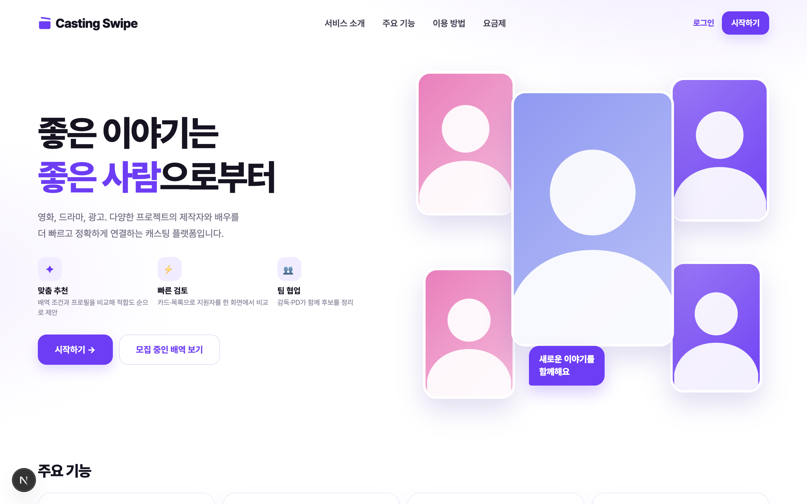
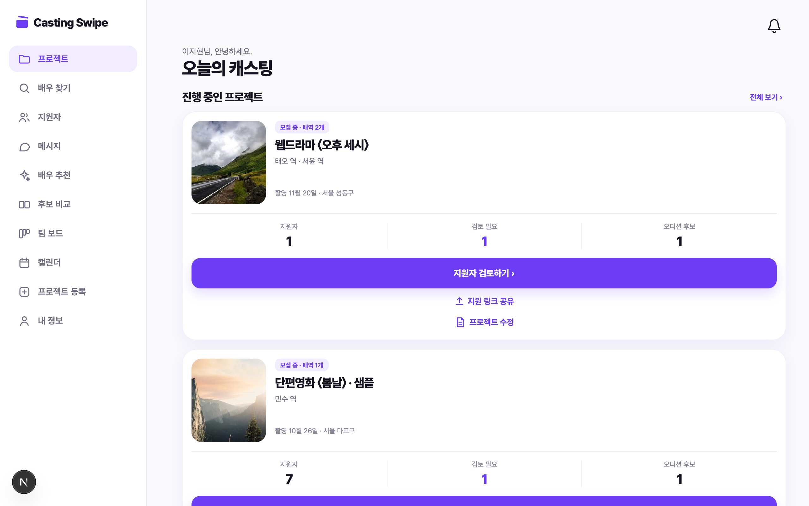
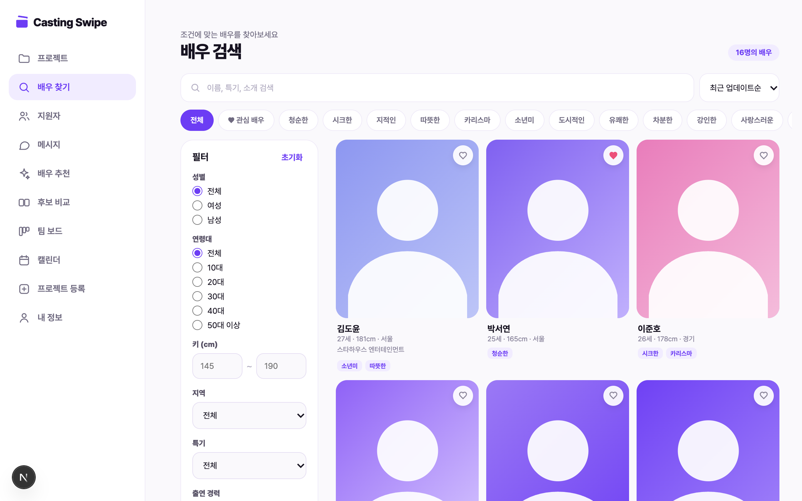
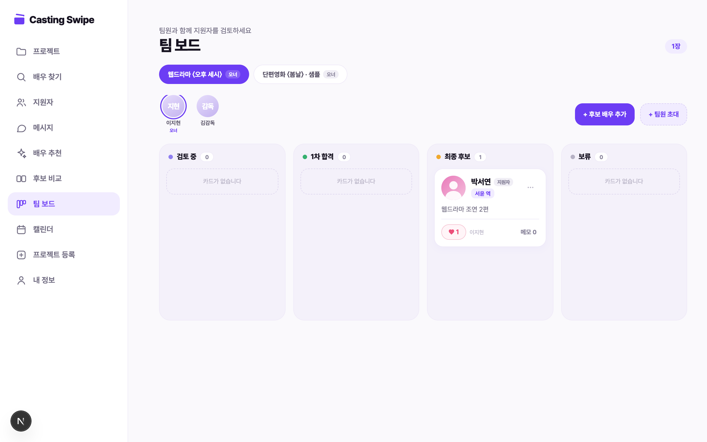

<div align="center">

# 🎬 캐스팅 스와이프

### Casting Swipe — 소규모 제작팀과 배우를 연결하는 캐스팅 플랫폼

공고 링크 하나로 지원을 받고, **추천·비교·팀 투표**로 최종 후보를 정하고, **오디션 일정**까지 한 곳에서.

배우는 앱 설치 없이 공유된 링크로 바로 지원합니다. 모바일 퍼스트 **반응형 웹(PWA)** 입니다.

<br>

[](https://nextjs.org)
[](https://react.dev)
[](https://www.typescriptlang.org)
[](https://pnpm.io)
[](#-검증-명령)
[](public/manifest.webmanifest)

<br>

[빠른 시작](#-빠른시작) · [주요 기능](#-주요-기능) · [구조](#-구조) · [협업 가이드](#-협업-가이드) · [로드맵](#️-다음-할-일-백로그)

```bash
pnpm install && cp .env.example .env.local && pnpm dev
```

</div>

---

<div align="center">

| 랜딩 | 제작자 스튜디오 |
|:---:|:---:|
|  |  |
| **배우 검색** | **팀 보드** |
|  |  |

</div>

---

## ✨ 주요 기능

**제작자**

| 기능 | 화면 | 내용 |
|---|---|---|
| 프로젝트·배역 | `/studio`, `/studio/projects/new` | 4단계 등록 마법사(임시 저장), 프로젝트 수정, 배역별 공개 지원 링크 |
| 지원자 검토 | `/studio` | 지원자 목록·필터·내부 상태·메모, 공개 결과 단계 관리 |
| 배우 검색 | `/studio/actors` | 이름·성별·연령·키·지역·특기·경력·가능일 필터, 정렬·페이지네이션, 관심 저장 |
| 배우 추천 | `/studio/recommend` | 배역 조건과 프로필을 비교하는 **조건 기반 적합도 %** + 추천 이유 (외부 AI 아님 — 외모 평가·자동 캐스팅 결정 없음) |
| 후보 비교 | `/studio/compare` | 이상형 월드컵식 VS 토너먼트, 결과 저장 |
| 팀 보드 | `/studio/board` | 칸반(검토 중→1차 합격→최종 후보→보류), 팀원 하트 투표·댓글, 이메일 초대, **지원하지 않은 배우도 후보로 추가** |
| 오디션 캘린더 | `/studio/calendar` | 월간/목록 뷰, 채팅에서 확정·조율 중인 오퍼 자동 병합, 장소·대면/비대면, 시간 충돌 감지 |
| 메시지 | `/studio` (메시지 탭) | 지원자별 채팅, 오디션 시간 제안→배우 선택→확정 |

**배우**

| 기능 | 화면 | 내용 |
|---|---|---|
| 프로필 관리 | `/me/profile` | 완성도 %, 사진 업로드(대표 지정), 태그·특기, 필모그래피, **PDF 자료실**, 출연 불가일, 미리보기 |
| 배우 홈 | `/me` | 받은 캐스팅 제안 수락/거절, 내 지원 현황, 모집 공고 |
| 지원·현황 | `/apply/[slug]`, `/status/[token]` | **가입 없이도** 링크로 지원 가능, 로그인 배우는 프로필 자동 채움, 오디션 시간 선택 |

---

## 🚀 빠른 시작

**요구사항**: Node.js 24+, pnpm

```bash
pnpm install
cp .env.example .env.local   # SESSION_SECRET을 24자 이상 임의 문자열로 수정
pnpm dev
```

`http://localhost:3000` 접속 → 데모 계정으로 로그인하거나 새로 가입하세요.

### 데모 계정 (비밀번호 전부 `demo1234`)

| 역할 | 계정 | 설명 |
|---|---|---|
| 제작자 (오너) | `producer@demo.casting` | 샘플 프로젝트 2개·지원자·오디션 데이터 포함 |
| 제작자 (팀원) | `director@demo.casting` | 김감독 — 첫 프로젝트 팀원, 팀 보드 협업 데모용 |
| 배우 | `actor01`~`actor16@demo.casting` | 프로필 완성된 배우 16명 (검색 공개) |

첫 실행 시 데모 계정·샘플 배역·가상 지원자가 자동 생성됩니다. 끄려면 `.env.local`에 `SEED_DEMO=false`.

---

## 🧱 기술 스택

- **Next.js 16.4** (App Router, Server Components + Route Handlers) · **React 19** · **TypeScript 5.9** · **pnpm**
- **DB**: 로컬 SQLite — Node 내장 `node:sqlite` (`data/casting.sqlite`, git 추적 안 함)
- **인증**: 이메일 + scrypt 비밀번호 해시 + HMAC 서명 세션 쿠키 (`src/lib/auth.ts`)
- **업로드**: 로컬 `data/uploads/` (이미지·PDF, 매직바이트 검증, 5MB)
- **PWA**: 매니페스트·아이콘·홈 화면 설치

> ⚠️ **배포 주의**: SQLite·업로드가 로컬 파일이라 Vercel 같은 서버리스는 불가 — 상주형 서버(Railway/Render/VPS) + `data/` 볼륨이 필요합니다. 실제 서비스용 권장 스택(Next.js + Supabase)은 [docs/STACK_PROPOSAL.md](docs/STACK_PROPOSAL.md) 참고.

---

## 📁 구조

```
src/
  app/                 # App Router 페이지 + API
    api/               # roles, applications, actors, board, calendar, compare,
                       # recommendations, proposals, favorites, auth, uploads ...
    studio/            # 제작자: 홈 / actors / recommend / compare / board / calendar / projects
    me/                # 배우: 홈 / profile
    apply/[slug]/      # 공개 지원 (무가입)
    status/[token]/    # 지원자 상태·오디션 응답
  lib/
    db.ts              # 스키마 + 쿼리 (단일 파일 SQLite 레이어)
    accounts.ts        # 사용자·프로필·프로젝트·제안
    board.ts           # 팀 보드(후보·투표·메모)
    calendar.ts        # 캘린더 이벤트 + 오퍼 병합  ← DB 의존
    calendar-grid.ts   # 순수 월그리드/충돌 로직    ← 리프 모듈(클라이언트 import 가능)
    fit.ts             # 적합도 점수 (순수 함수)
    compare.ts         # 토너먼트 브래킷 (순수 함수)
    auth.ts / session-token.ts / validation.ts / profile.ts
tests/                 # node:test 단위 테스트 (33개)
docs/                  # PRD 보조 문서, API 계약, 기술 설계, 협업 규칙
```

### ⚠️ 개발 시 주의 (Next 16 + 이 프로젝트 규칙)

1. **AGENTS.md 필독** — 이 버전의 Next는 breaking change가 있습니다. 코드 작성 전 `node_modules/next/dist/docs/` 관련 가이드를 확인하세요. (`params`는 Promise로 await, `cookies()` await 등)
2. **클라이언트에서 DB 모듈 import 금지** — `lib/db.ts`·`lib/accounts.ts`·`lib/calendar.ts`를 `'use client'` 파일에서 import하면 `node:sqlite`가 브라우저 번들에 섞여 500이 납니다. 클라이언트는 리프 모듈(`calendar-grid.ts`, `fit.ts`, `compare.ts`, `profile.ts`)의 타입/순수 함수만 import 하세요.
3. **권한**: API는 서버에서 `getProducerId()`/`getActorId()`로 역할 검증. 제작자는 자기 프로젝트(팀원 포함)만, 배우는 자기 데이터만.
4. **테이블 추가**: `db.ts`의 `CREATE TABLE IF NOT EXISTS` + `addColumn()` 패턴으로. 기존 DB 마이그레이션 자동.

## 🧪 검증 명령

```bash
pnpm typecheck      # tsc --noEmit
pnpm test           # node --test tests/*.test.mjs
pnpm build          # next build
pnpm format:check   # prettier --check
pnpm format         # prettier --write
```

화면은 **390px(모바일)** 과 **1280px(데스크탑)** 두 폭에서 확인하세요.

## 🤝 협업 가이드

1. `main`에 직접 푸시하지 말고 브랜치 → PR로. 규칙은 [docs/COLLABORATION.md](docs/COLLABORATION.md)
2. 커밋 전 `pnpm typecheck && pnpm test && pnpm format` — CI 없이 로컬에서 확인
3. 코드 스타일: Prettier(2칸·싱글쿼트), 한국어 UI copy는 해요체
4. 기능 명세는 [PRD.md](PRD.md), 진행 현황은 [docs/IMPLEMENTATION_BACKLOG.md](docs/IMPLEMENTATION_BACKLOG.md)
5. **비밀값 커밋 금지** — `.env.local`, `data/`는 gitignore 됨. 새 env 키는 `.env.example`에 예시로만 추가
6. AI는 외모 평가·캐스팅 자동 결정을 하지 않습니다 (PRD 원칙) — 추천은 조건 기반 점수 + 사람 결정

## 🗺️ 다음 할 일 (백로그)

- 셀프테이프(지정대사) 요청·제출·비교 재생 — PRD 차별화 핵심 단계
- 조건 판정 Hard Filter(충족/불충족/미확인 자동 분류) + 지원서 '참여 의사' 항목
- 카드 스와이프 검토(←제외 ↑보류 →관심) — 앱 이름의 주인공
- 알림 발송(결과 통보·오디션 안내), 지원자 '열람' 상태, KPI 지표 화면
- 실서비스 전환: Supabase 이전(인증·DB·Storage), 소셜 로그인, 비밀번호 재설정

자세한 계획은 [docs/IMPLEMENTATION_BACKLOG.md](docs/IMPLEMENTATION_BACKLOG.md)와 [docs/TECHNICAL_DESIGN.md](docs/TECHNICAL_DESIGN.md) §7을 참고하세요.

---

<div align="center">

팀 프로젝트 — 내부 사용 · Made with 💜 for film crews & actors

</div>

### Vercel 체험 배포

`DEMO_MODE=true`와 24자 이상 무작위 `SESSION_SECRET`을 설정하면 제작자·배우 체험 버튼으로 바로 입장합니다. 빌드 시 가상 계정·배역·지원자가 담긴 SQLite 스냅샷을 만들고 각 함수의 임시 디렉터리에 복사합니다. 모든 함수가 동일한 초기 ID를 사용하므로 로그인·프로필·지원 링크가 연결됩니다. 서버가 재시작되면 변경 내용과 업로드는 초기화되며, 함수 사이에서 체험 중 변경 사항의 공유는 보장하지 않습니다. 실제 운영에는 영구 DB·파일 저장소가 필요합니다.
