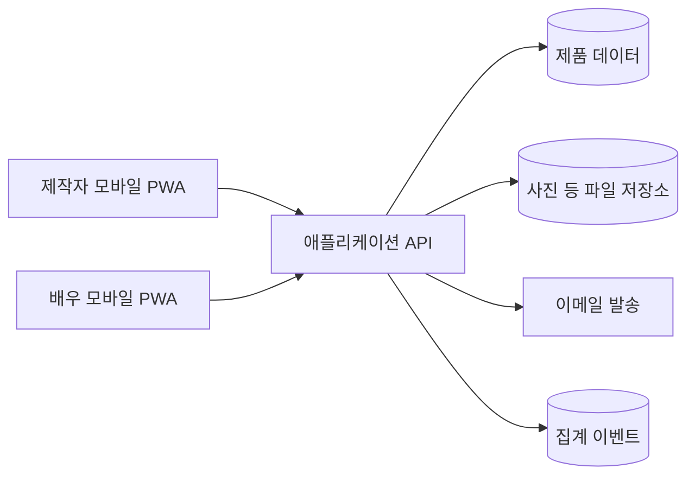
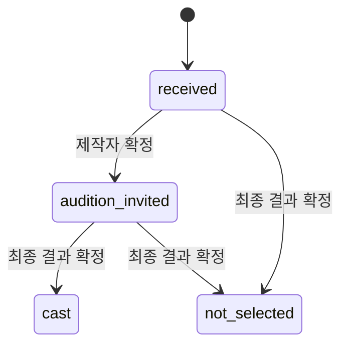

# 캐스팅 스와이프 MVP 기술 설계

**상태:** 구현 전 설계 초안  
**범위:** [PRD](../PRD.md)의 R01~R10·R17

## 1. 시스템 경계

- **모바일 PWA 클라이언트:** 제작자에게 배역·지원자 검토 UI를, 배우에게 지원·진행 현황 UI를 제공한다. 같은 앱의 역할별 경로를 사용하며, 홈 화면 설치 없이 브라우저로도 접근할 수 있다.
- **애플리케이션 API:** 인증과 권한 검사를 통과한 요청만 처리한다. 배역 게시, 지원서 제출, 내부 평가와 공개 결과의 상태 전환을 한곳에서 검증한다.
- **제품 데이터:** 프로젝트·배역·지원서·평가·상태·후보 목록의 기준 저장소다. 업무 데이터와 분석 이벤트를 섞지 않는다.
- **파일 저장소:** 배우가 올린 사진 등 미디어를 비공개로 저장한다. 연기 영상은 초기 비용과 업로드 안정성을 확인할 때까지 URL 제출을 기본안으로 둔다.
- **이메일:** 지원 접수 확인과 확정된 결과 안내에 사용한다. 발송 실패가 지원서 저장을 취소하지 않도록 별도 작업으로 처리한다.

제공자와 라이브러리는 [협업 문서의 미결정 사항](COLLABORATION.md#결정이-필요한-사항)에서 확정한다. 클라이언트가 DB·파일 저장소에 직접 쓰는 방식을 선택하더라도 아래 권한·상태 규칙은 서버 측 규칙 또는 검증 가능한 정책으로 강제해야 한다.

## 2. 접근 권한

| 행위 | 제작자 | 배우 | 익명 방문자 |
| --- | --- | --- | --- |
| 공개된 배역 보기 | 가능 | 가능 | 가능 |
| 배역 생성·수정·마감 | 해당 프로젝트 권한 보유자 | 불가 | 불가 |
| 지원서 제출 | 본인 지원 시 가능 | 가능 | 인증 정책에 따라 가능 |
| 지원서 전체·내부 메모 보기 | 해당 프로젝트 권한 보유자 | 불가 | 불가 |
| 본인 지원·공개 상태 보기 | 본인 지원 시 가능 | 본인만 가능 | 불가 |
| 오디션·최종 결과 공개 | 해당 프로젝트 권한 보유자 | 불가 | 불가 |

**설계 제안:** 제작자는 이메일 인증 후 프로젝트를 관리한다. 배우는 앱 설치 없이 링크에서 지원하되, 지원서 재조회·수정과 결과 조회에는 본인 이메일을 확인하는 일회성 링크 또는 동등한 인증을 사용한다. 인증 수단은 구현 전에 확정한다. 지원 링크 자체는 배역 정보를 보는 용도이며 지원자 자료 조회 권한을 주지 않는다.

## 3. 주요 처리 흐름

### 배역 게시

1. 제작자가 프로젝트와 배역 초안을 저장한다.
2. API가 필수 공고 정보와 마감·촬영 날짜의 유효성을 검사한다.
3. 게시 시 사람에게 공유할 수 있는 고유 슬러그를 발급한다.
4. 게시 후 공고 내용의 변경은 기록한다. 촬영일·보수 등 지원 판단에 큰 영향을 주는 변경은 이미 지원한 배우에게 알릴 방법을 마련한다.
5. 마감 또는 수동 종료 후에는 새 지원을 거절하고 기존 지원 정보는 권한자에게 남긴다.

### 지원서 제출

1. 배우가 공개 배역을 읽고 필수 정보와 연기 영상 URL 또는 허용된 파일을 입력한다.
2. 서버가 게시 상태, 마감 시각, 필수 항목, 업로드 완료 상태를 확인한다.
3. 지원서를 저장하고 접수 시각과 공개 상태 `received`를 기록한다.
4. 접수 확인 화면을 즉시 보여준다. 이메일 발송은 실패하면 재시도 가능하도록 기록한다.
5. 같은 배우의 같은 배역 중복 제출과 수정 가능 시점은 첫 개발 회의에서 결정한다. 그전에는 중복을 조용히 덮어쓰지 않는다.

### 검토와 후보 확정

1. 제작자가 자신의 배역 지원자만 조회한다.
2. 필수 조건은 `충족`, `불충족`, `미확인`으로 계산한다. 누락을 불합격으로 처리하지 않는다.
3. 내부 평가(`new`, `reviewing`, `hold`, `pass`, `interested`)와 내부 메모를 저장한다.
4. 제작자가 후보를 명시적으로 선택하면 배역별 후보 목록에 추가한다. 목록의 예상 인원은 5~10명이지만 UI가 임의로 인원을 강제하지 않는다.
5. 오디션·최종 결과는 별도 확정 동작을 거친 뒤 배우 공개 상태와 안내 메시지에 반영한다.

## 4. 상태 모델

내부 평가는 제작자의 작업 상태이고, 공개 결과는 배우가 확인할 수 있는 결정이다. 둘은 독립 필드로 유지한다.

- 지원을 받자마자 배우에게 보이는 상태는 `received`다.
- `hold`, `pass`, `interested`, 메모와 팀 의견은 공개하지 않는다.
- 알림은 공개 상태 전환이 확정될 때만 생성한다. 동일 전환 재시도로 중복 알림이 나가지 않게 한다.
- 결과 안내 예정일이 지나도 확정 결과를 임의로 생성하지 않는다. 연기·변경 사실을 별도 안내한다.

## 5. 오류와 예외 처리

| 상황 | 제품 동작 |
| --- | --- |
| 마감 직전에 제출 | 서버 수신 시각 기준으로 판단하고, 접수 여부를 명확히 표시 |
| 업로드 실패 | 실패한 파일을 제출 완료로 표시하지 않고 재시도 수단 제공 |
| 이메일 전송 실패 | 지원서는 저장하되 발송 상태를 남기고 재시도. 제작자에게 허위 ‘통보 완료’ 표시 금지 |
| 삭제·비공개된 미디어 | 지원자 카드에 자료를 볼 수 없다는 상태를 표시하고 다른 필드는 유지 |
| 동일 요청 재시도 | 지원서 제출·결과 확정에 중복 생성 방지 키 적용 |
| 권한 없는 접근 | 객체 존재 여부가 드러나지 않도록 일관된 접근 거절 응답 |
| 날짜·시간 | 저장은 시간대가 포함된 절대 시각으로, 화면은 `Asia/Seoul`로 표시 |

## 6. 품질과 검증

- **단위 검사:** 필수 조건의 3값 판정, 상태 전환, 마감 시각, 후보 목록 중복 방지.
- **통합 검사:** 권한별 조회·수정 거절, 지원서 저장과 이메일 실패 분리, 비공개 파일 접근.
- **브라우저 과업 검사:** 휴대전화에서 제작자 배역 게시→배우 지원→제작자 검토·후보 확정→배우 결과 조회. 좁은 화면, 터치, 키보드 조작을 포함한다.
- **PWA 검사:** HTTPS 배포, 매니페스트·아이콘, 홈 화면 설치 후 시작 경로, 설치하지 않은 브라우저의 직접 링크, 네트워크 끊김 안내를 iPhone과 Android에서 확인한다. 오프라인에서 쓰기를 성공으로 표시하지 않는다.
- **시범 운영 계측:** 배역 게시, 지원 시작·완료, 첫 검토, 내부 평가 변경, 후보 확정, 공개 결과 확정의 이벤트와 시각을 기록한다. 원문 프로필·연기 영상은 분석 이벤트에 넣지 않는다.

## 7. 배포 전 확인

1. 실제 배역 없이도 동작을 재현할 수 있는 가상 프로젝트·지원자 데이터가 있다.
2. 익명 사용자·배우·다른 프로젝트 제작자의 접근 차단을 직접 확인했다.
3. 비공개 사진 URL이 만료·권한 검사 없이 외부에 노출되지 않는다.
4. 마감된 배역에 지원할 수 없고 기존 지원은 권한자에게 보인다.
5. 접수·결과 안내의 발송 성공·실패를 운영자가 확인할 수 있다.
6. 시범 운영 지표를 계산하는 이벤트가 누락 없이 기록된다.
7. 휴대전화에서 제작자와 배우의 핵심 과업이 완료되고, 설치형·브라우저형 모두 같은 권한 정책을 따른다.
